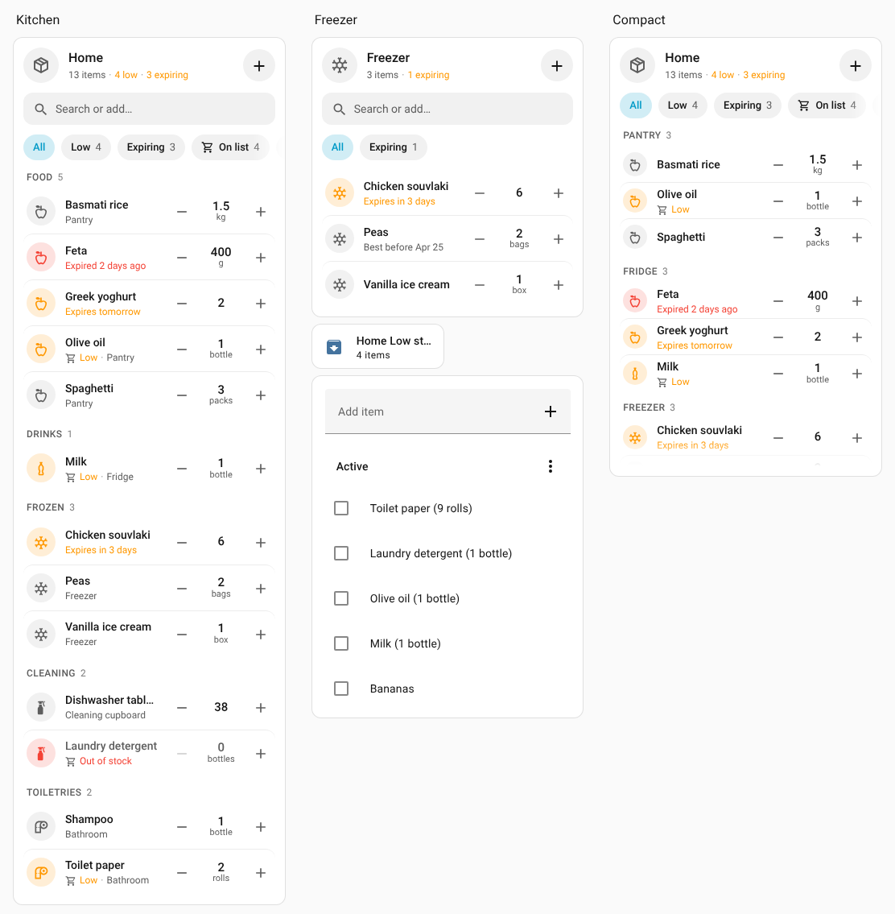
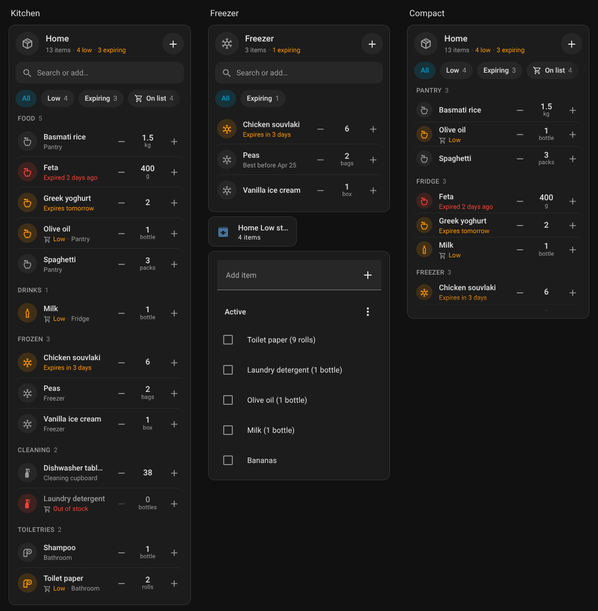
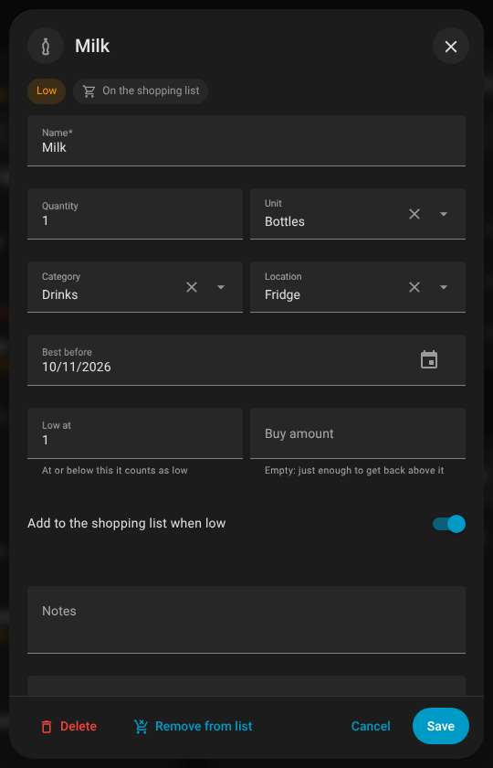
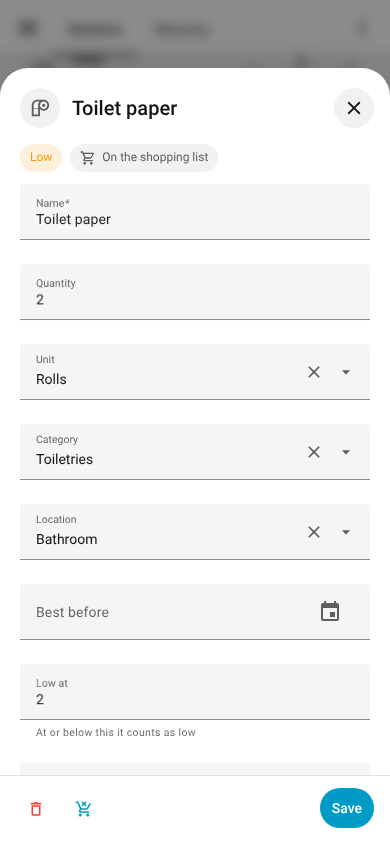
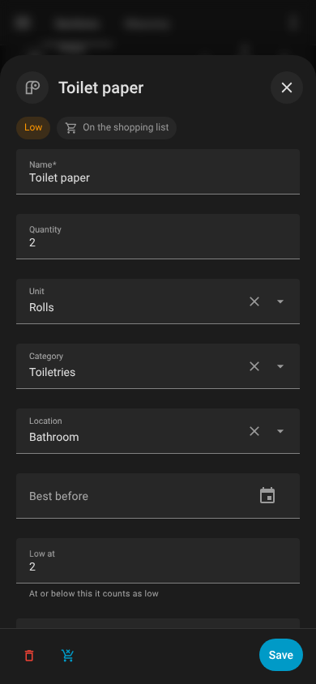
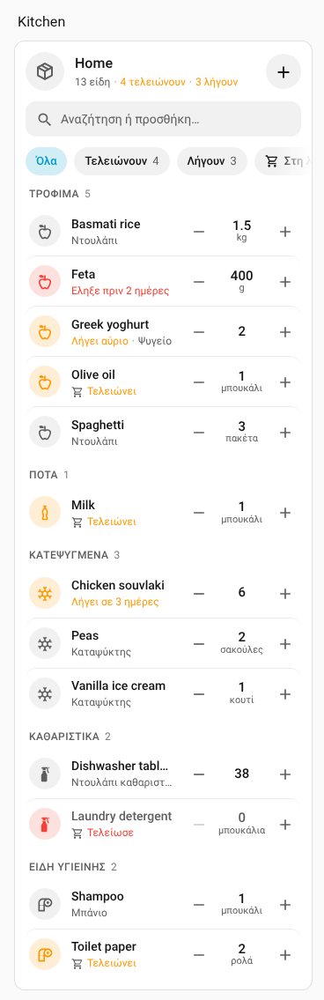

# Stock Pulse

A household inventory for Home Assistant, with a shopping list that fills itself and a sleek dashboard card to run it.

- Keep count of what you have at home: quantity and unit (pieces, packs, rolls, bottles, kg…), category, location (pantry, fridge, **freezer**…), best-before date, notes.
- **Opened it?** Things that keep only a few days once open (cold cuts, sauces, milk) can say so: tap **Opened** in the item's sheet, and *Expiring soon* follows the open pack instead of a best-before date months away.
- Give an item a **threshold** and it goes on your shopping list by itself when stock drops to it.
- **Tick it off the shopping list** when you buy it and the bought amount is added back to the inventory.
- A card that looks at home next to the built-in cards: search and quick add, filter chips, grouping, +/- steppers, and an edit sheet. English and Greek.
- **Bought it on the way home?** One tap on **Bought** in an item's sheet adds the amount you'd buy (or the amount on its shopping-list entry) and takes it off the list.
- **Scan a barcode** to put the shopping away: a pack you already have opens with one more of it; a new one opens the add sheet with its name filled in from [Open Food Facts](https://world.openfoodfacts.org). The barcode stays with the item, so the next scan needs no internet.

Screenshots are from Home Assistant 2026.2 (sections view, built-in light and dark themes).





| Edit sheet, dark | Phone, light | Phone, dark | Greek |
| --- | --- | --- | --- |
|  |  |  |  |

**Themes:** the card takes every colour from your Home Assistant theme, so it follows light, dark and auto mode and any custom theme without settings. Colour is used only for items that need attention, and only on the item's icon and the words that say why (*Low*, *Expires tomorrow*); everything else stays neutral. When nothing needs attention, the header says *All stocked up*. With the [Pulse theme](https://github.com/zacharatos/pulse-theme), it reads the theme's shared `--pulse-*` tokens and sits with the other Pulse cards as one family.

## Why an integration and not just a card

A card only runs while a dashboard is open. The shopping-list loop has to work when you tick an item off on your phone in the supermarket, from the companion app, a voice assistant or another to-do app. So Stock Pulse is a small integration that stores the inventory and watches the shopping list, and it serves the card itself. One HACS install gives you both; there is no dashboard resource to add.

## Install

1. HACS → ⋮ → **Custom repositories** → add `https://github.com/zacharatos/stock-pulse-integration`, type **Integration**.
2. Install **Stock Pulse** and restart Home Assistant.
3. **Settings → Devices & services → Add integration → Stock Pulse.** Name the inventory and pick a shopping list (any to-do entity; the built-in `todo.shopping_list` is suggested).
4. Add the card: edit a dashboard → **Add card** → **Stock Pulse Card**.

Minimum Home Assistant version: 2025.7.

## The shopping-list loop

```
 quantity drops to the threshold ──▶  "Toilet paper (9 rolls)" is added to the shopping list
                                                 │
                    ticked off in any app ◀──────┘
                                 │
                                 ▼
               +9 rolls added back to the inventory
```

- **Threshold ("Low at")**: an item is low when its quantity is at or below it. Items without a threshold are never added automatically.
- **Buy amount**: how much to buy each time (a 9-pack of toilet paper). Leave it empty and Stock Pulse buys just enough to get back above the threshold. The entry's text follows the stock while it is on the list.
- **You change the amount in the list** (`Milk (4 bottles)`)? That is what gets restocked.
- **You buy it without the list** (you raise the quantity yourself)? The open entry is removed.
- **You delete the entry from the list** without buying? It is not added again until the item has been above its threshold once.
- **Entries typed by hand** (`Milk`, `dish soap (2)`) restock an item with the same name when ticked off. Turn this off in the options if you don't want it.
- **Run out and restock** clears the old best-before date, since that batch is gone.
- Entries that were already ticked off when you set the integration up are treated as history, not purchases.

Every rule can be switched in **Settings → Devices & services → Stock Pulse → Configure**: shopping list, add low items, restock when bought, match hand-typed entries, remove bought entries from the list, and how many days count as "expiring soon".

Works with any to-do integration that supports adding, updating and removing items (Shopping list, Local to-do, and most cloud lists).

## The card

```yaml
type: custom:stock-pulse-card
```

That is a complete config. Everything below is optional and available in the visual editor.

| Option | Default | What it does |
| --- | --- | --- |
| `inventory` | the only one | Config entry id or name of the inventory, when you have more than one. |
| `title` | inventory name | Card title. |
| `icon` | `mdi:package-variant-closed` | Card icon. |
| `group_by` | `category` | `category`, `location` or `none`. |
| `sort` | `name` | `name`, `quantity` (lowest first) or `expiry` (soonest first). |
| `locations` | all | Only show these locations, e.g. `[freezer]` for a freezer card. New items get that location. |
| `categories` | all | Only show these categories. |
| `show_search` | `true` | The search box, which doubles as quick add: type a name and press Enter. |
| `show_filters` | `true` | Chips for All, Low, Expiring, On list and each location. |
| `show_scan` | `true` | The barcode button in the header (shown only where the camera can scan; see below). |
| `hide_out_of_stock` | `false` | Hide items at 0 (the Low chip and search still find them). |
| `compact` | `false` | Shorter rows; only urgent details are shown under a name. |
| `max_height` | none | e.g. `480px`; the list scrolls inside the card. |

A freezer card:

```yaml
type: custom:stock-pulse-card
title: Freezer
icon: mdi:snowflake
locations: [freezer]
group_by: none
sort: expiry
```

Tap a filter chip again to go back to everything. In an item's sheet, **Bought** appears when the item is low, out, or on the shopping list: it adds the amount on the list entry (or the buy amount) in one go, and the entry disappears from the list, exactly as if you had ticked it off.

## Opened packs

Give an item **Keeps after opening (days)**, the line on the label that says "keeps 10 days in the fridge after opening". When you open one, tap **Opened** in its sheet: today becomes its *Opened on* date, and the date that counts is whichever comes first, the best-before or opened + those days. The row then says *Opened · use within 2 days*, and the item shows up under *Expiring* and in the expiring sensors in time.

- Buying more while one is open keeps the open pack's date. Running out and restocking clears it, since the new packs are sealed.
- Using the open one up (− on a counted item, or a whole pack's worth of a weighed item that has a buy amount) clears the date, and **Opened** is offered again for the next pack. Eating part of it (1.5 → 1.4, or 100 g of a 400 g tub) keeps it.
- The *Opened on* date can be corrected in the sheet, and both fields can be set from actions (`opened_on`, `days_after_opening`).

## Scanning barcodes

The **barcode button** in the card's header opens a barcode scanner. Point the phone at the barcode on a pack:

- **A pack you already have** (its barcode is on an item): that item's sheet opens with one more of it added, its *Buy amount* if it has one (a 9-pack of rolls, a 400 g block), otherwise one step. **Save** keeps it.
- **A new pack:** the add sheet opens with the name, a category and the brand and pack size (in *Notes*) from [Open Food Facts](https://world.openfoodfacts.org), or from Open Beauty Facts and Open Products Facts for toiletries and household things. Check it, add a date or a threshold, and save.
- **Not in any database** (many local and own-brand products aren't): the add sheet opens empty. Give it a name and save. The barcode is kept either way, so the next scan of that pack is recognised straight away.

Only the barcode digits are sent, to Open Food Facts and its sister databases, and only for barcodes that aren't on an item yet. Answers are kept in memory for a while. No account or key is needed. The product data is © Open Food Facts contributors, [ODbL](https://opendatacommons.org/licenses/odbl/1-0/).

Where it works:

- **In the companion app** the card uses the app's own scanner, so it works however you reach Home Assistant, **local IP and plain `http://` included**, with no certificate or domain.
- **In a browser** the card uses the browser's camera, which browsers only allow on **HTTPS** (Home Assistant Cloud, or your own certificate), in Chrome or Edge (Android, or a laptop with a camera). On plain `http://`, Safari or Firefox the button doesn't show in the browser.
- **A handheld USB or Bluetooth barcode scanner works everywhere:** click the search box and scan. The card treats the digits the same way.
- The scanner also has a field to **type the numbers**, for a barcode the camera can't read.
- Barcodes appear in an item's sheet once it has one, and you can edit them there (several, separated by commas). Searching for the digits finds the item.

Built-in units, categories and locations are translated; you can also type your own (a "Garage" location, a "Ferments" category, a "carton" unit).

## Sensors

Each inventory gets four sensors, each with an `items` attribute listing the matching items (with `expiry`, the best-before date, and `use_by`, the date that counts once a pack is open):

| Sensor | Counts |
| --- | --- |
| `sensor.<name>_in_stock` | items with quantity above 0 |
| `sensor.<name>_low_stock` | items at or below their threshold, or at 0 |
| `sensor.<name>_expiring_soon` | items whose date is within the "expiring soon" days |
| `sensor.<name>_expired` | items past their date |

## Actions

All take an optional `inventory` (needed only if you have several). `item` is a name (case-insensitive), an id, or one of the item's barcodes.

| Action | Use |
| --- | --- |
| `stock_pulse.add_item` | Add an item; if one with that name (or that `barcode`) exists, its quantity is increased. |
| `stock_pulse.update_item` | Change any field. `barcode` adds one barcode to the item; `barcodes` replaces the list. |
| `stock_pulse.adjust_quantity` | `amount: -1` when you finish one, `+6` when you unpack. Great on an NFC tag. |
| `stock_pulse.remove_item` | Delete an item. |
| `stock_pulse.add_to_shopping_list` | Put an item on the list now. |
| `stock_pulse.sync_shopping_list` | Read the list now (it is also read on every change and every 10 minutes). |
| `stock_pulse.get_items` | Returns items (`only: low / out / on_shopping_list`, `location`, `category`) for scripts and voice assistants. |

## Events

`stock_pulse_low_stock`, `stock_pulse_added_to_shopping_list` and `stock_pulse_restocked`, with the item's name, quantity, unit, location and category.

### Example: a morning heads-up about expiring food

```yaml
triggers:
  - trigger: time
    at: "08:00:00"
conditions:
  - condition: numeric_state
    entity_id: sensor.home_expiring_soon
    above: 0
actions:
  - action: notify.mobile_app_phone
    data:
      title: Use these soon
      message: >
        {{ state_attr('sensor.home_expiring_soon', 'items') | map(attribute='name') | join(', ') }}
```

### Example: an NFC tag on the coffee cupboard

```yaml
triggers:
  - trigger: tag
    tag_id: coffee
actions:
  - action: stock_pulse.adjust_quantity
    data:
      item: Coffee
      amount: -1
```

## Development

```bash
npm install
npm run typecheck && npm test && npm run build   # card → custom_components/stock_pulse/frontend/
bash scripts/install-test-deps.sh && pytest     # integration
python3 -m http.server 8765                      # then open /test/harness.html (?dark=1, ?lang=el, ?missing=1)
pwsh scripts/deploy-dev.ps1                      # maintainer: try a build in your own HA before tagging (Samba share)
```

The built card is committed on purpose: HACS installs `custom_components/stock_pulse` straight from the tag. See [AGENTS.md](AGENTS.md) for the project's working rules.
